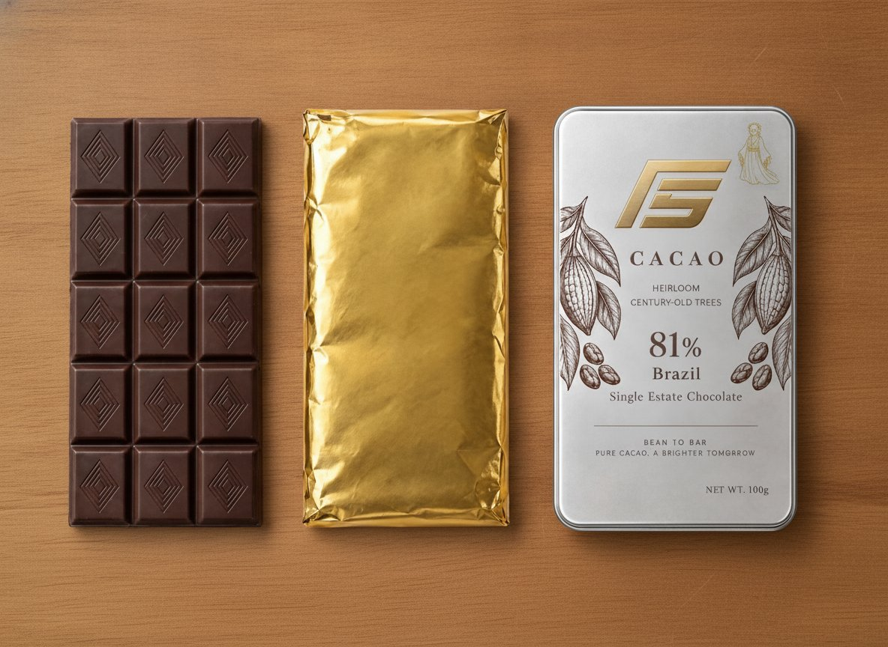
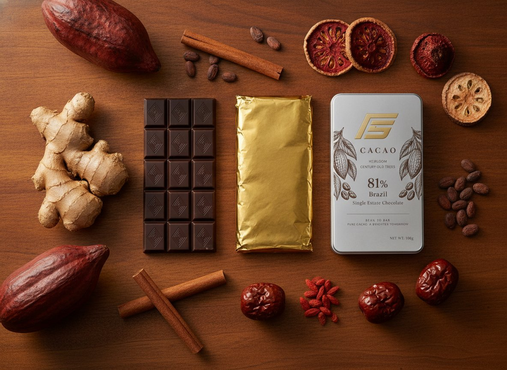
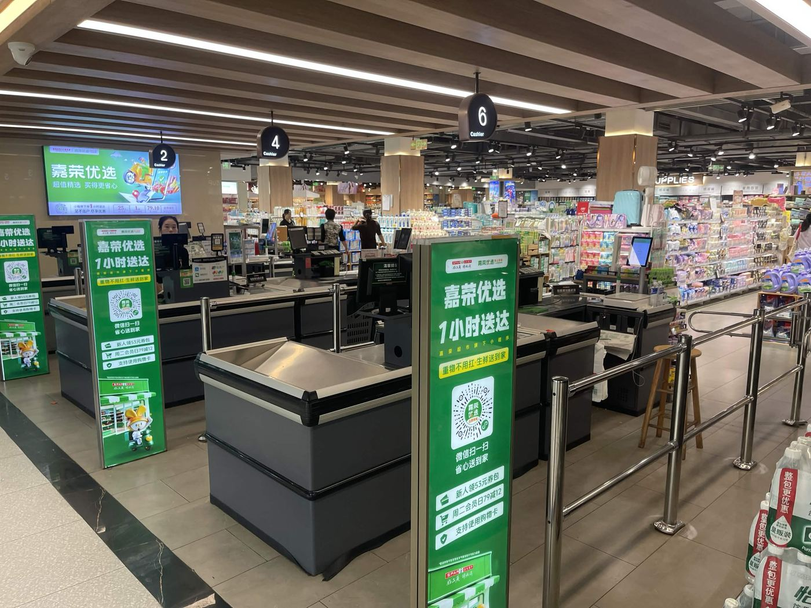
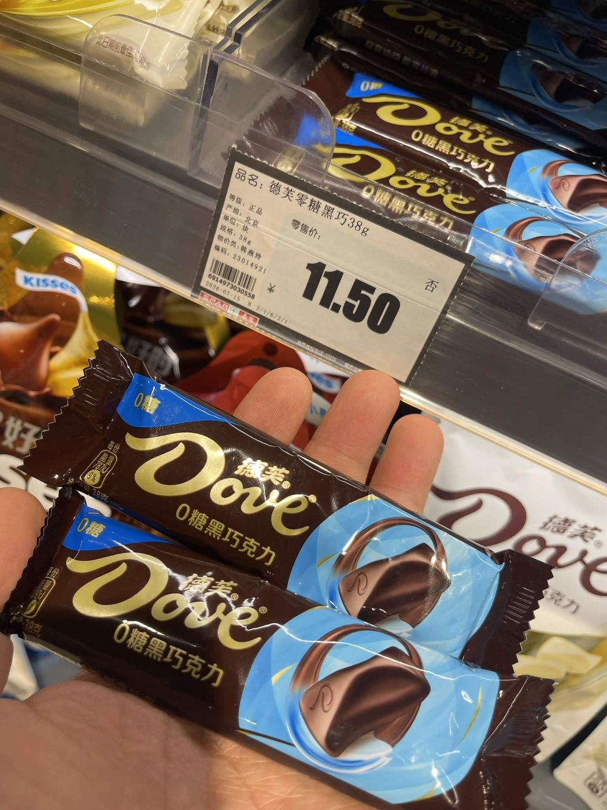
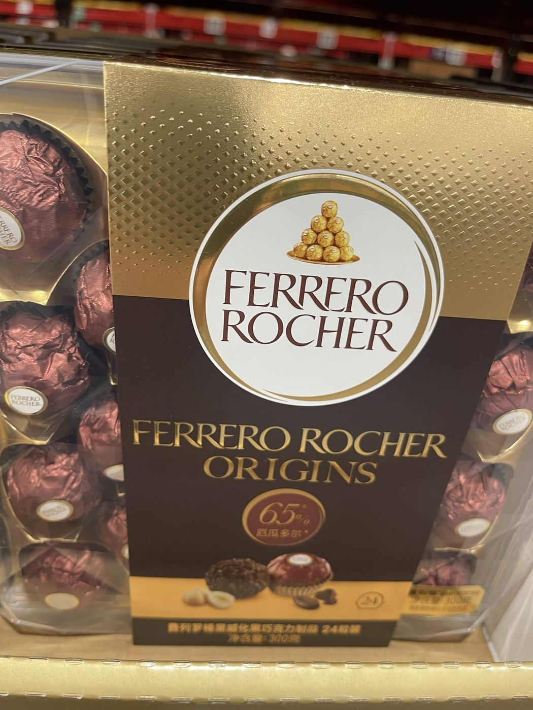
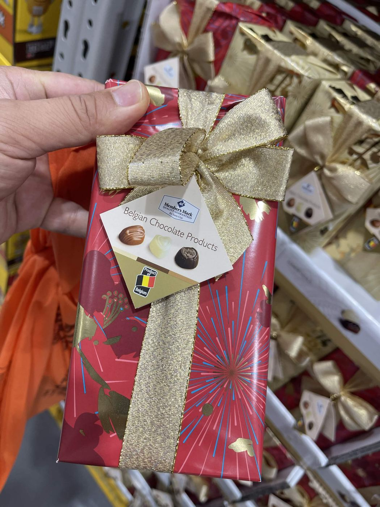
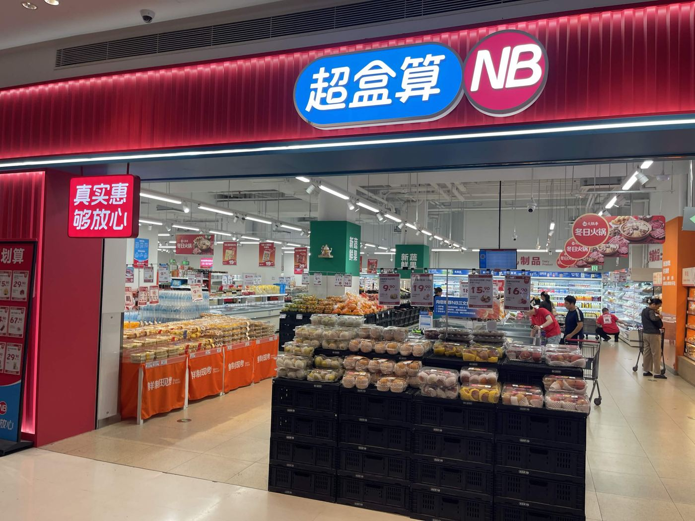
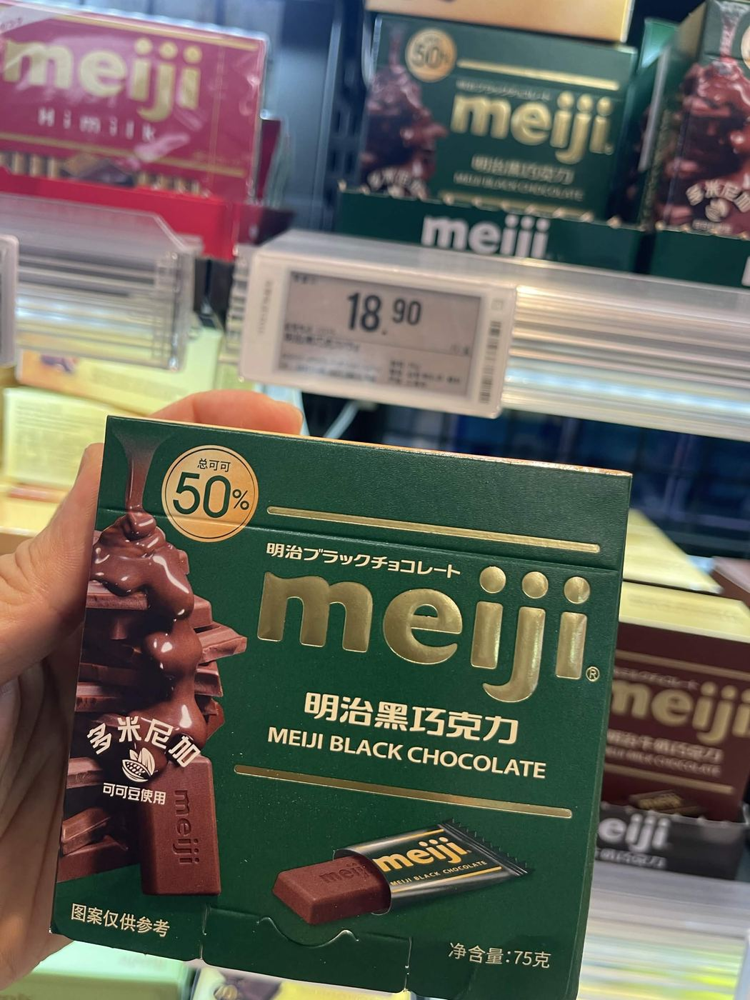
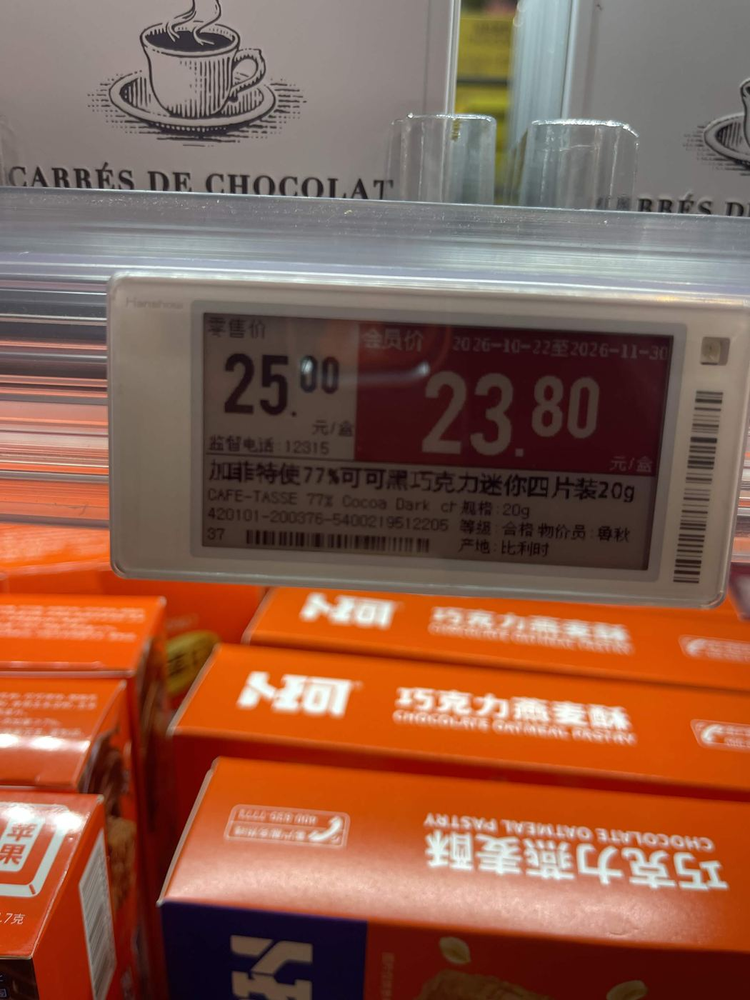
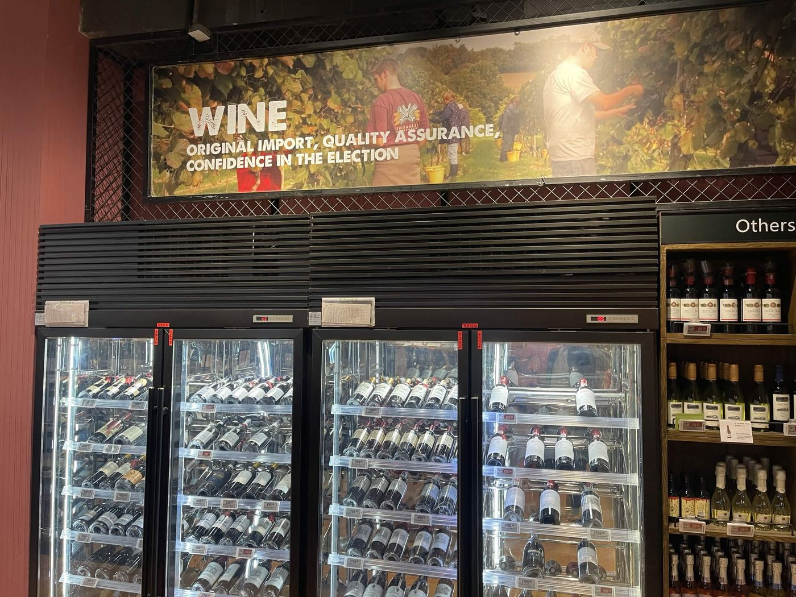

# F5 81% Bar — China Market Entry: SKU, Channel, Packaging & Price

**Compiled from:** 4 field-visit stops (嘉荣/SPAR, Sam's Club, 超盒算NB, blt/万象汇 MixC — Dongguan, 2026-11-12/13), Jerrie Huang's market study (*China's Dark Chocolate Market: From Category Baseline to the 81% Cacao Tier*, 2026-11-12), Gary's own field observations, and existing unit-cost references. Evidence-backed claims are cited; everything else is flagged as judgment or a gap.

**Gary's brief for this compile:** figure out the best entry in terms of **SKU format and channel**, plus **differentiation in terms of packaging, price point, and product attribute.** The sections below are organized around those five decisions directly.

**Brand architecture — a 2026-11-14 decision, recorded here because it changes every downstream recommendation:** this China entry ships under **F5**, not Agroverse. **Agroverse stays the USA consumer brand; F5 is the standalone China consumer brand**, sourced from the same farms, the same DAO provenance/QR backend, and the same regenerative mission — just a different shelf-facing name and identity for this market (reference packaging already exists: silver tin, gold angular "F5" monogram, engraved cacao-pod line art — see §4). Where this report says "Agroverse," it means the parent DAO/mission/ledger (e.g. "Main Ledger, tab `Agroverse SKUs`" is a real backend system name and stays as-is); where it means the product on a Chinese shelf, it says **F5**.

---

## Executive summary — five decisions, one evidence base

| Decision | Recommendation | Why (one line) |
|---|---|---|
| **Brand** | **F5**, not Agroverse — Agroverse stays USA-only | Gary's explicit 2026-11-14 decision; same farms/DAO backend, separate China shelf identity (see note above) |
| **SKU format** | A **single-estate 50g bar** — Oscar's Farm, Bahia, century-old heritage, SKU already exists — with **rotating collectible wrapper-art editions**, not a 4-estate box | One estate = one lot = one GACC/CIFER filing, resolving Gary's logistics/consolidation objection to the original 4-bar box; century-old heritage is a stronger single Truth than "four estates" (§4) |
| **Channel** | Specialist/gifting retail, café/HORECA, premium-format supermarkets (blt/Ole'/MixC tier) | **Never** general supermarket gondolas or discount channels (NB-type) — same price reads as 3–5× the best-seller there, an error not a premium |
| **Packaging differentiation** | QR code **per bar** → Oscar's Farm lot registry; century-old-tree story on the wrapper; collectible wrapper-art mechanic (framework **not yet chosen** — 5 options compared in §4, Gary deciding) | The one claim on the entire 22-SKU shelf no competitor can copy: independently-verifiable, per-unit provenance |
| **Price point** | **RMB 71–78 for the single 50g bar at launch**; boxed multi-edition sets priced as a set, not N× the single price (see §6) | The cost model and the field comparable do **not** converge (an earlier draft claimed they did — corrected in §6). RMB 71–78 sits at parity-to-modest-premium over the one real comparable found (Café-Tasse, ¥1,250/kg); RMB 88+ is a test-and-learn ceiling, not the launch price |
| **Product attribute** | Lead with **composition + provenance** (cacao %, century-old estate, vintage/lot, third-party assay); **never** a health or functional claim | China legally closes the functional-claim register for cocoa (普通食品 only) — this is not a copywriting choice, see §2 |

**The core finding underneath all six:** China's chocolate market is a low-base, value-over-volume category (~RMB 24bn, 0.1 kg/capita — a tenth of Japan's), but products above 80% cacao are growing at **21%/year, more than 3× the category rate**, and **no shelf found — mass, premium import, or domestic challenger — combines a named single estate, vintage/lot, third-party lab testing, and per-unit QR traceability.** F5 already has all four pieces on one estate; the job is packaging and channeling them correctly, not inventing a new story.

### Reading the five decisions through McCann's "Truth Well Told" lens

Gary asked whether McCann Worldgroup's framework was worth applying here. It is — not as a forced overlay, but because it names something this report already arrived at independently. McCann's model (per their own public materials) is **Truth → Well → Told**: find a genuine, verifiable truth; tell it so it becomes impossible to ignore; place it so it's impossible to avoid. Mapped onto the five decisions above:

| McCann stage | What it means here | Which decision does the work |
|---|---|---|
| **Truth** (impossible to deny) | The actual, checkable fact — not a claim. On this shelf, every competitor's story is a label assertion; ours is the only one with a verification chain behind it (named estate + vintage + lot + third-party assay + a QR a shopper can scan themselves). | **Product attribute** (§2, §4) — composition and provenance only, never a functional claim, because the functional register is both legally closed *and* the weaker truth next to the one we actually have. |
| **Well** (impossible to ignore) | Making the truth vivid and experiential, not a sentence in small print. A hundred-year-old farm is an abstraction until it's *felt* — which is what the collectible wrapper-art mechanic is for (§4): each edition makes the same verifiable estate story newly vivid without changing the underlying claim. | **SKU format + packaging** (§4) — single-estate F5 bar, QR per bar, century-old-tree story on the wrapper, collectible wrapper editions (framework TBD). |
| **Told** (impossible to avoid) | Placing the truth where the audience that can actually recognize it will encounter it — not everywhere, deliberately not everywhere. | **Channel + price** (§5, §6) — blt/Ole'/MixC-tier and gifting/HORECA only; the same truth, told in an NB aisle, isn't "ignored" so much as *mis-heard* as an error. |

The reason this lens is useful rather than decorative: it gives a one-sentence test for any future China-market decision that isn't already covered above — **does this make the truth more verifiable (Truth), more felt (Well), or reach the audience that can recognize it (Told)? If it does none of the three, it's not building the brand, whatever else it's doing.**

---

## 1. The demand — real, but narrower than "chocolate is popular"

Gary's original field observation (*"there is a demand for dark chocolate in China, seems to be popular for fat loss"*) is directionally correct but the mechanism is wrong, and the distinction matters commercially:

| Signal | Figure | Source |
|---|---|---|
| China chocolate confectionery market | ~RMB 24bn (2025), ~2% of global consumption | OC&C 2026 trend report |
| Per-capita consumption | ~0.1 kg/yr (vs ~1 kg Japan, 0.6 kg Korea) | OC&C |
| Dark chocolate share of category | 8–10% | Maishangying offline panel |
| **Above-80%-cacao segment growth** | **21%/yr — 3× the category rate** | Jerrie's study §2 |
| Single-origin ingredient CAGR | 9.15% — fastest-growing ingredient segment of all | Mordor 2026 |
| Offline retail trend | **−7% YoY in 2025** — growth is price-led, not volume-led | Maishangying |

**The "fat loss" belief is real in consumer perception but traces to a retracted hoax** — the 2015 *"Chocolate with High Cocoa Content as a Weight Loss Accelerator"* paper (International Archives of Medicine) was a deliberate fraud by journalist John Bohannon, retracted 10 June 2015, but still cited uncritically in at least 8 later publications. Real RCT evidence (cocoa in obese adults, 2008–2019) shows flavanol benefits to vascular function and insulin resistance, but **no significant effect on BMI, waist circumference, or body fat.** This is not just a scientific footnote — it is a **legal constraint** (§2 below), and the two confirmed shelf listings in Gary's original screenshots (每日黑巧, Bouchard) both independently avoided any functional claim, which is the market's own evidence of where the legal line sits.

---

## 2. The regulatory constraint — read this before writing any shelf copy or box copy

This is not a style preference; it is a hard category lock, verified against existing workspace docs (`OSCAR_FARM_CHINA_ACTION_PLAN.md`, `CACAO_TCM_APPLICATION.md`) and confirmed independently by Jerrie:

- **Cocoa is 普通食品 (ordinary food) only.** It appears on neither the 药食同源目录 (106-item food-and-medicine list) nor the 可用于保健食品的物品名单 (the list of ingredients a registered health food may contain).
- **普通食品 may carry zero functional claims of any kind.** Not fat-loss, not "stamina," not "aphrodisiac" — and not softened synonyms either. 抗疲劳/耐力/体能 all map to a registered **保健食品 蓝帽 (blue-hat)** function name and carry the same legal exposure as the word they're meant to replace.
- **Enforcement is active, not theoretical.** Recent SAMR cases named 瘦身咖啡 and 代用茶 for false 保健功能 claims; of 11 网红瘦身食品 tested, 6 contained banned substances (sibutramine, prescription diuretics). Being perceived as adjacent to that category is a real commercial hazard.
- **The EU flavanol claim (≥200mg DP1–10, "maintains blood-vessel elasticity") is EU-authorised only and unusable in China.** It is an export-market asset, not a China one — do not let it leak into China-facing copy.
- **The only durable, legally safe vocabulary is compositional + sensory + lifestyle + provenance**: cacao %, sugar content, per-piece kcal, origin, format, and — our genuine differentiator — single-estate/vintage/lot/QR traceability.
- **Correction:** an earlier pass of this report claimed the real shelf competitors "stayed strictly inside this register." **That's wrong for CHOCDAY 每日黑巧**, confirmed via a later, more thorough field pass (Sophia's companion audit, `reports/china_market_positioning_2026/FIELD_AUDIT_AND_SWOT_2026-11-13.md`, merged `agentic_ai_context` PR #1837): its pack prints **膳食纤维有助于维持正常的肠道功能** ("dietary fiber helps maintain normal intestinal function").

**Second correction, per Sophia's `ERRATA_V2_2026-11-14.md` (PR #1840):** that claim does not actually contradict "zero functional claims of any kind" the way the first correction implied — it sharpens it. China's claim regime for 普通食品 has two registers, not one:

| Claim class | Chinese term | Available to 普通食品? |
|---|---|---|
| **Health-food function claim** (the 27 蓝帽/blue-hat functions — 减肥, 增强免疫力, 缓解体力疲劳…) | 保健功能声称 | **No** — requires 蓝帽 registration |
| **Nutrient function claim** (dietary fibre, calcium, protein…) | 营养素功能声称 | **Yes**, when content meets the GB 28050 threshold and the wording follows the standard verbatim |

CHOCDAY's dietary-fiber line is a **GB 28050 营养素功能声称** — lawful on an ordinary food, not a blue-hat health claim. That's why it's legally on shelf and not an enforcement target. So "普通食品 may carry zero functional claims of any kind" (as stated earlier in this section) is too absolute: the **standard nutrient-claim register is open**; only the **blue-hat health-function register is closed**. The recommendation to avoid functional-style claims stands for strategic reasons (CHOCDAY already owns that ground; we'd invite substantiation burden we don't need), not because the law bans every claim — and this precise classification should still be confirmed by a Chinese regulatory consultant before anything ships to a label.

**The recipe can carry the story. The label can only carry verifiable facts.** This governs the packaging recommendation in §4 directly.

---

## 3. The competitive shelf — field evidence, 4 stops, 22 SKUs

Gary visited **4 of 8 planned locations** in Dongguan (2026-11-12 to 2026-11-13); the remaining 4 were judged confirmatory rather than decisive and the trip was closed at 4 stops as a reasonable stopping point, not an incomplete survey — see §8. **80 photos were analysed** in the companion field audit across all four stops (0 carry GPS EXIF — stops are identified by storefront signage, receipts, and price-tag timestamps). 10 of those were re-reviewed directly for this memo, out of 87 uploaded across both passes.

### Stop sequence

| Time | Store | Type | Photos |
|---|---|---|---|
| 05:27–05:41 | **嘉荣 SPAR / 嘉荣荟 (Jmall)**, 寮步 | Mid-tier mall, value tenant mix | 19 |
| 06:35–06:39 | **山姆会员商店 Sam's Club**, 寮步 | Membership warehouse, bulk/gift format | 27 |
| 07:20–07:23 | **超盒算NB 大朗卓为城店** | Hard-discount community supermarket (盒马旗下) | 14 |
| 08:08–08:10 | **blt supermarket, 万象汇 MixC** | Premium-format supermarket — **⚠️ unplanned stop, found by accident** | 11 |

The 4th stop (blt) was not on the original plan and turned out to be the single most important data point in the entire trip — see §5.

### The 22-SKU price ladder (¥/kg), lowest to highest — with format noted

**Corrected from an earlier 18-SKU version:** four real SKUs found at blt — exactly the premium-format store this report's channel recommendation targets — were missing from the first pass, caught by Sophia's independent audit. They're added below at their correct position; they fill in the ¥239–375/kg band, which matters directly since it's the zone the §6 price recommendation is now judged against.

| ¥/kg | Brand | Product | Format | Size | Shelf price | Store |
|---|---|---|---|---|---|---|
| 113.49 | Dove 德芙 | 丝滑牛奶(碗装) | single bar/bowl, 1 flavor | 252g | ¥28.60 | NB |
| 120.08 | Dove 德芙 | 什锦装 3口味 | multi-flavor box | 249g | ¥29.90 | NB |
| 127.60 | Dove 德芙 | 香浓黑巧(碗装) | single bar/bowl, 1 flavor | 250g | ¥31.90 | SPAR |
| 159.80 | Member's Mark | 黑巧薄脆片 | single-format wafer bag | 500g | ¥79.90 | Sam's |
| 198.21 | Bouchard | 低糖 80% 黑巧 (3 flavors) | **multi-flavor box** | 504g | ¥99.90 | Sam's |
| **198.67** | **Meiji 明治** | **超纯黑巧克力 70%** | single bar, 1 flavor | 75g | **¥14.90** | **NB — see photo** |
| 199.60 | Member's Mark | 什锦比利时 Ballotin | **curated assortment box** | 250g | ¥49.90 | Sam's |
| 199.80 | I.MM | 无糖黑巧克力 | single bar, 1 flavor | 500g | ¥99.90 | Sam's |
| 202.59 | Lindt | LINDOR 软心甄选 | **curated selection box** | 888g | ¥179.90 | Sam's |
| 208.00 | Ferrero | 榛果威化 | single format | 375g | ¥78.00 | NB |
| 222.99 | Galaxy | 可可原粹黑巧 | single bar, 1 flavor | 448g | ¥99.90 | Sam's |
| **239.00** | **Ritter Sport** | **100g bar** | single bar, 1 flavor | 100g | **¥23.90** | **blt — added** |
| 252.00 | Meiji 明治 | 黑巧 50% | single bar, 1 flavor | 75g | ¥18.90 | blt — added |
| 252.00 | Meiji 明治 | 超纯黑巧 70% | single bar, 1 flavor | 75g | ¥18.90 | blt — added |
| 299.67 | Ferrero | 榛果威化黑巧 65% 24粒 | multi-piece box | 300g | ¥89.90 | Sam's |
| 318.00 | Beryl's 倍乐思 | 跳跳糖薄荷 | single bar, 1 flavor | 50g | ¥15.90 | NB |
| **375.00** | **Meiji 明治 钢琴** | **代可可脂 (CBS)** | single bar, 1 flavor | 120g | **¥45.00** | **blt — see §3 cocoa-butter correction** |
| 416.25 | Rabitos Royale | 无花果巧克力 | single bar, 1 flavor | 240g | ¥99.90 | Sam's |
| 537.04 | Beryl's 倍乐思 | 黑巧克力 99%可可 | single bar, 1 flavor | 108g | ¥58.00 | SPAR |
| 588.89 | CHOCDAY 每日黑巧 | 醇萃黑巧 98%* | single bar, 1 flavor | 27g | ¥15.90 | NB |
| **1,250.00** | **Café-Tasse** | **77% 黑巧迷你四片 (Belgian)** | **mini multi-piece, tasting portion** | 20g | **¥25.00 / ¥23.80 member** | **blt — see photo** |
| **1,420.00** | **← F5 81% bar, Oscar's Farm (@ existing Agroverse-brand US $10 price, same chocolate)** | — | single bar, 1 flavor (current US format) | 50g | — | — |
| **1,420–1,560** | **← F5 81% bar @ revised RMB 71–78 recommendation (§6)** | — | single bar, 1 flavor | 50g | — | — |

*CHOCDAY's "98%" is a denominator trick confirmed on its own nutrition panel: the figure applies only to the chocolate *portion* of the product; inulin (菊粉) is ~34% of total bar weight, so cocoa is ~60% of the whole product, not 98%. CHOCDAY is manufactured in Jiangsu (SC11331012007397 family) despite marketing itself as Swiss-made. **All 22 ladder SKUs above are confirmed real cocoa butter (可可脂) except the Meiji "钢琴" (Piano) row (¥375/kg)**, which is explicitly labeled **代可可脂 (cocoa butter *substitute*)** on its own shelf tag, confirmed by photo — so the correct count is **21 of 22 real, 1 of 22 substitute**, not "17 of 18" as an earlier pass stated (that count predated the 4 BLT SKUs added above, and separately miscounted which row the substitute was relative to). The substitute-vs-real distinction does **not** track cleanly with price tier (this sits mid-ladder, at a premium-format store) — which makes "100% real cocoa butter" a usable, factual differentiation claim even against some shelf-neighbors at the same premium store, not just against mass-market SKUs.

**The format pattern, read straight down the "Format" column:** every SKU above ¥1,000/kg is either a curated multi-origin/multi-flavor box (Ballotin, LINDOR) or a small tasting-portion multi-pack (Café-Tasse) — and **no single-flavour single bar exists above that line**. Format does *not* track price across the lower ladder: three curated boxes (Bouchard ¥198.21, Member's Mark Ballotin ¥199.60, LINDOR ¥202.59) all sit *below* ¥230/kg, and single bars run far above it (CHOCDAY ¥588.89, Beryl's ¥537.04). The defensible claim is therefore top-rung only, and that is the evidence behind the SKU-format recommendation in §4.

### Photographic evidence from the trip

**Café-Tasse shelf price tag, blt supermarket (the decisive data point, for both price and format):**
`01_cafe_tasse_price_tag_BLT.jpg` — electronic shelf label reading 零售价 ¥25.00/盒, 会员价 ¥23.80/盒, product "加啡特使77%可可黑巧克力迷你四片装20g / CAFE-TASSE 77% Cocoa Dark," 产地: 比利时 (Belgium). Note the format: **迷你四片装** — "mini four-piece set," not a single bar. This is both the pricing comparable (§5) and the format comparable (§4).

**Meiji shelf tags, 超盒算NB (mass-market) vs blt (premium) — resolved per Sophia's errata §3:** `02_meiji_price_tag_NB.jpg` shows ¥14.90 at NB for the 70% Venezuelan-origin 75g bar (¥198.67/kg, in the ladder above). The earlier draft had merged this with a separate ¥18.90 blt tag for the same nominal product — those are two different stores' prices on what are actually two distinct SKUs (NB's 70% at ¥14.90, and blt's own 50%/70% pair at ¥18.90 each, both now in the ladder above as their own rows). Two real findings survive the fix: **zero price premium** for 70% vs 50% at blt (both ¥18.90, same 75g), and a **+27% channel premium** for the same 70% SKU at blt (¥18.90) vs NB (¥14.90).

**blt wine section (store-tier context):**
`03_blt_wine_wall_context.jpg` — full wine wall at blt, bottles priced ¥600–2,600 under signage reading "Original Import, Quality Assurance." This is the general price register of the store the Café-Tasse comparable sits in — confirms blt is a genuine premium-import retail environment, not an outlier shelf in an otherwise mass-market store.

**Fuller BLT venue review — confirms and extends the "credible premium retail" finding beyond this one photo:**

- **Mall context** (`04_mixc_mall_entrance.jpg`): blt sits inside 万象汇 MixC, a modern upscale mall (brushed-steel entrance, 10:00–22:00 hours) — a shopper is visible exiting frame carrying a branded gift bag, consistent with the gifting-channel thesis in §5.
- **Storefront** (`05_blt_storefront_deli_juicebar.jpg`): official "blt supermarket" branding, a staffed deli/prepared-food counter (熟食区域供应快餐及美食), and a fresh-pressed juice bar immediately inside the entrance — a Whole-Foods/City-Super-style format, not a conventional grocery with one nice aisle.
- **Wine wall, fuller view** (`06_blt_wine_wall_full_view.jpg`): four full refrigerated doors plus an adjacent section, price tags visible up to **¥2,699** — higher than the ¥600–2,600 range cited above; the store's premium register runs wider than the first photo alone showed.
- **Checkout** (`09_blt_biodegradable_bags.jpg`): biodegradable shopping bags (生物降解购物袋, ¥2.0/¥1.2) at checkout — a concrete, independent signal that blt's own brand positioning already leans sustainability-forward. **This is a usable pitch point, not a coincidence**: blt is premium *and* already sustainability-branded, which lines up with Agroverse's regenerative-farming story rather than being an unrelated detail.

**A third SKU-format data point** (`10_zodiac_choco_cereal_italy.jpg`, from the same BLT visit, posted separately as "Zodiac chocolate"): **Per Piacere — Zodiac Choco Cereal**, a 30g Italian milk-chocolate novelty sphere with a malted-cereal center. The brand name 卡卡星座 ("Choco Zodiac") and two differently-labeled spheres (Virgo, Leo) photographed together strongly suggest a 12-sign collectible set, but **no zodiac sign or "12-piece set" language was confirmed printed on the pack itself** — stated here as a reasonable inference from what was photographed, not a confirmed fact (an earlier draft stated it as fact; corrected per Sophia's review). Not a direct dark-chocolate competitor (different composition, different positioning — novelty gifting, not provenance-led premium), but it reinforces the §4 pattern: **small-unit, collectible, gift-set formats are a live, successful pattern at this store across multiple price tiers and chocolate types**, alongside Café-Tasse's tasting-portion format and the Ballotin/LINDOR box format.

(Further unprocessed photos from all 4 stops are saved at `/tmp/claude-1000/-home-ubuntu/0481bee1-293d-44a6-9533-3f342c15a4d1/scratchpad/report_images/` — 10 photos reviewed directly and described above out of 87 total uploaded; the remaining BLT-series angles and the earlier three stops' full photo sets were not individually reviewed, stated honestly as a scope limit, not a finding.)

---

## 4. SKU format and packaging — the entry format question

**The field evidence contains a direct answer to the format question: it isn't just price that separates the premium register from the mass register — it's format.** Re-reading the "Format" column in §3's ladder: **every SKU above ¥1,000/kg is either a curated multi-origin box or a small tasting-portion multi-pack, and no single-flavour single bar exists above that line.** That top rung is the clean, defensible version of the claim (per Sophia's errata §2), and it is the evidence behind this section's recommendation. Note precisely what it does *and* does not say: **format tracks the top rung, not the whole ladder.** Three curated boxes — Bouchard ¥198.21, Member's Mark Ballotin ¥199.60, LINDOR ¥202.59 — sit *below* ¥230/kg, and single bars run far above it (CHOCDAY ¥588.89, Beryl's ¥537.04). So the pattern is "no premium-tier single-flavour single bar," not "boxes are what premium means": the top of this ladder is a **gifting register, and gifting is boxed**.

### Recommended SKU: a single-estate F5 bar (Oscar's Farm, Bahia), not a multi-estate box

**This recommendation changed on 2026-11-14, and the reason is worth recording.** The earlier 4-bar discovery box (superseded by this section) was a correct read of the shelf pattern — the premium tier is boxed — but it was never a *human truth*, just a format match. Gary raised a real operational objection: coordinating four separate estates/harvest-years into one shipment is a logistics and consolidation problem for a first China entry, on top of everything else already gating this launch (§8). **The fix solves both problems at once: one estate, one lot, one GACC/CIFER registration line — and a stronger single Truth than "four estates" ever was.**

**The estate: Oscar's Farm, Bahia — confirmed against the live farm page (`agroverse_shop_prod/farms/oscar-bahia/index.html`), not assumed.** A **100-year-old farm**, **80-year-old Criolla trees still producing today**, Atlantic Forest cabruca system, Coopercabruca cooperative, three generations of the same family. The bar SKU already exists (`organic-81-dark-chocolate-bar-50g-oscar-bahia-2024`) — this is the fastest estate to actually launch on, not just the most romantic one.

**A second real single-origin option exists and was considered: Paulo's La do Sitio, Pará — genuinely Amazon biome** (confirmed against `agroverse_shop_prod/farms/paulo-la-do-sitio-para/index.html`: "Amazon rainforest of Pará," CEPOTX cooperative, award-winning), and directly embodies the DAO's own mission ("restore 10,000 hectares of Amazon rainforest" — this is literally that forest). Its trees are ~40 years old, not century-old — **"100-year-old Amazon rainforest tree" is not a single true story; it fuses two different farms.** Paulo's farm also has **no bar SKU today** (only a 200g ceremonial pouch and raw beans), though its 274 kg 2024 lot is the same one the volume estimate in §9 is built on and "available for Go" conversion to bars (`plans/AORA_EXPERIENCE_PLAN.md` §300). Gary's call: **launch on Oscar (ready today); Paulo/Amazon stays a live option for a second F5 release once its own bar SKU exists** — not a reason to delay this one.

### The brand: F5, not Agroverse — and why "Sage"

Per Gary's 2026-11-14 decision (recorded at the top of this memo), **this product ships as F5**, a standalone China consumer brand on the same farms/provenance backend as Agroverse (USA-only). Reference packaging already exists — silver tin, gold angular "F5" monogram, engraved cacao-pod line art, "Heirloom Century-Old Trees" — and that last line was already true of Oscar's Farm before this pivot, which is a good sign the brand and the estate choice agree with each other rather than having to be forced together.

**Brand archetype: Sage**, from the Jungian/Pearson 12-archetype model (a brand-*voice* tool — picks one identity, unlike the 12-piece collectible below, which is a packaging-*format* tool; the two aren't interchangeable, and this memo uses each for what it's actually built for). Sage fits the evidence directly: a century-old farm, a verification chain a shopper can check themselves, "Truth Well Told" positioning already built around checkable fact over functional claim (§2's McCann table). Explorer (frontier, discovery) would fit a future Paulo/Amazon release better — worth keeping in mind if that second F5 SKU ever ships.

### The collectible mechanic — five frameworks compared, not yet decided

The shelf evidence for *some* collectible/boxed mechanic at the premium tier is real and already established (§3's format-pattern finding; Per Piacere's **卡卡尼星座** zodiac spheres, found at blt, confirmed on the purchase receipt at ¥26.8/30g — **¥893/kg**, genuinely premium pricing for a 12-sign collectible novelty format, not just a gifting footnote). The question this memo worked through with Gary directly was *which* collectible system — copying Per Piacere's Western zodiac was the lowest-imagination option on the table. **Five frameworks have been compared and sample wrapper art generated for most of them; none has been finalized — this is a live menu, not a decision record.**

| System | Regulatory/cultural read | Distinctiveness vs. Per Piacere | Status |
|---|---|---|---|
| Western zodiac (Per Piacere's own mechanic) | Safe — Per Piacere already proves it | None — this would be copying the shelf-neighbor directly | Considered, not pursued further |
| 生肖 (Chinese zodiac animals) | Safe, zero regulatory touchpoint, huge existing commercial precedent (CNY zodiac-year drops) | Low — same structural idea as Per Piacere, Chinese dress only | Sample generated (dragon, engraved line-art style) |
| Wu Xing (五行) as an explicit on-pack diagram/claim | **Caution** — Wu Xing is the literal theoretical basis of TCM (the same 五味 framework the Phase-2 flavor subsection above uses internally); printing it as a named framework risks reading as TCM-adjacent | Moderate | Sample generated (geometric diagram) — not recommended in this form |
| Wu Xing (五行) as decorative guardian-*character* art, no framework name, no body/health claim | Re-assessed mid-conversation and softened from the row above: used purely as mascot/character art (the same category as zodiac animals, not a claim), the risk is materially lower — the actual danger zone is Wu Xing tied to organ/body effects, which stays firewalled in the Phase-2 TCM subsection | Moderate-high | Two samples generated (Fire, Water) — Water clean, Fire has a layout bug |
| I Ching (易经), 64 hexagrams (or a curated subset) | Cleanest regulatory profile of any option — philosophy/culture classic, no 药食同源 or 保健食品 touchpoint at all | High — connects directly to the Sage archetype (Jung, who originated the 12-archetype model, wrote the foreword to the best-known Western I Ching translation) | Sample generated (single hexagram motif) |
| Six Realms (六道), illustrated literally, doctrine named on-pack | **Not recommended** — core religious doctrine, not folklore; two of the six realms (地狱/hell, 饿鬼/hungry ghost) are unappetizing associations for a food gift | High, but at a real cost | Rejected in this literal form |
| Six Realms, as non-literal evocative spirit-guardian characters, **no realm named on-pack** | Softer risk than the row above — tested directly, reads as premium guardian-character art rather than doctrine illustration; still a judgment call, not a bright regulatory line (see caveats below) | High | Two samples generated (ghost/饿鬼-inspired, warrior/修罗-inspired), plus a cleaner final composition |
| **12 Jungian/Pearson brand archetypes** (Explorer, Rebel, Lover, Sage, Hero, Magician, Creator, Innocent, Everyman, Jester, Caregiver, Ruler) **as the 12-piece illustrated character roster**, same evocative art style as the spirit-guardian samples | Zero religious or TCM-adjacency risk — not tied to any Chinese belief system at all, so nothing to misread | **Lower than the Chinese-cultural options** — this is a second borrowed (Western psychology) frame, not a China-specific one, even if illustrated in a China-resonant style; though it does let F5's own "Sage" sit inside its own collectible set as one of the twelve, which is a genuinely elegant self-reference | Not yet sampled |

*Illustrative only, one of several directions under live comparison — not a finalized design. A minor text-rendering artifact ("TOMGRROW") is a generation glitch, not final copy.*

**Mechanic, common to every option above: one estate, one recipe, rotating wrapper-art editions** — not a new SKU per character, a new *wrapper print run* per character. This is the part that actually resolves Gary's logistics objection regardless of which framework wins: the chocolate production, the lot, the GACC/CIFER filing, and the QR/lab-data backend stay identical across every edition; only the printed wrapper art changes. A boxed set of several editions serves the gifting/collectible register the shelf data rewards (§3) without re-introducing the cross-estate coordination problem the 4-bar box had.

**Open, honestly, rather than resolved by this memo alone:**
1. **No framework has been chosen.** Five are on the table (生肖, Wu Xing-as-character, I Ching, Six Realms-as-character, 12 archetypes); this memo's lean is I Ching for regulatory cleanliness and Sage-coherence, or Six Realms-as-character for visual impact — but this is Gary's call, not a conclusion this document reaches on its own.
2. **"Inspired by, not labeled as" (Six Realms option) is a judgment call, not a bright regulatory line.** A shopper familiar with 六道 will likely recognize the reference even without the name printed. Worth a second read from someone closer to Chinese Buddhist consumer sentiment before it ships, regardless of which way this leans.
3. **Layout needs real production design**, not an AI-generated concept image — every sample generated for this comparison lost label text to character art at least once before a usable composition was found.
4. **Character count and exact roster not decided** for whichever framework is chosen — none of 生肖's 12, I Ching's 64 (or a subset), or the archetypes' 12 has been narrowed to a launch set.

### Packaging differentiation — what to put on the wrapper the shelf comps can't

Every premium comparable found in the field (Café-Tasse, Bouchard, Lindt, Galaxy) leads with brand and cacao %. **None of them puts an individually-verifiable provenance chain on the package.** Three concrete, low-cost differentiators, now simpler with a single estate:

- **A QR code per bar, resolving to Oscar's Farm's own lot/harvest registry.** Single-estate makes this cleaner than the 4-estate version — one farm, one verification chain, independently checkable by any shopper who scans it. Still the one claim on the entire 22-SKU shelf no competitor can copy without the underlying traceability system behind it.
- **The century-old-tree story on the wrapper**, not buried in a shared ingredient panel — three generations, 80-year-old Criolla trees, named and dated, the way a wine label names its vineyard and vintage.
- **Composition and lab data on the box; sensory/provenance story on the wrapper.** Keeps the regulatory-safe register (§2) consistent across both surfaces: cacao %, origin, lot, third-party assay reference where a label-reading shopper looks; sensory and heritage language where a gift-receiver looks.

### A possible second product attribute — TCM-informed formulation (Phase 2, not the launch SKU)

Gary raised whether `CACAO_TCM_Application_Practitioner_Review_EN-ZH-PT.pdf` (Sophia's 2026-10 discussion document, prepared for Dr. Wong and Oscar's sister — both TCM practitioners) is a usable framework for the product-attribute decision. **It is — but as a formulation idea for a second, later SKU, not as anything that touches the label or the launch set, and not yet as a committed plan.**

**Why it's legally compatible with everything in §2.** That document's own central distinction is the one that makes it safe: TCM reasoning is proposed to drive **配伍** (what ingredients go in the recipe) and **炮制** (how it's processed — roast profile), never the **label**. Ginger, cinnamon, aged tangerine peel (陈皮), hawthorn (山楂), red dates (大枣), and goji (枸杞) are all independently confirmed against the official 106-item 药食同源 list — so an ordinary food can legally contain them. §2's rule stands untouched: **no TCM language, function name, or health claim may ever appear on a pack, website, or any public material** — the document is explicit that this reasoning can live in only three places (internal formulation brief, a one-to-one conversation with someone who already thinks in TCM terms, stopping short of any claim, and nowhere else) and names a fourth as absolutely forbidden: public material of any kind.

**Why it's a genuinely sharp fit for this specific market.** 陈皮 (aged tangerine peel) is a Guangdong specialty — Dongguan is in Guangdong — and 山楂片 (hawthorn fruit slices) and 红枣枸杞 (date-and-goji) are both familiar, well-loved everyday snack/tea flavors, not exotic ones. A "阿姜陈皮 / aged-peel-and-ginger" dark chocolate reads as a **regionally-resonant flavor innovation**, marketed purely on taste and ingredient terms — exactly the same safe register as a "chai-spiced" or "five-spice" chocolate bar anywhere else in the world — not as a wellness product.

*Concept mockup generated for this report — purely illustrative of the flavor-formulation idea, not a finished packaging design. No text beyond the existing brand mark; nothing on it constitutes or implies a health claim.*

**What's NOT yet true, and has to be before this moves anywhere near a roadmap:**

1. **No TCM practitioner has reviewed this.** The source document is explicitly split into "Part A" (sourced fact) and "Part B" (Sophia's own synthesis, flagged in the document itself as "the part most likely to be wrong") — and ends with seven open questions to Dr. Wong and Oscar's sister that, as of this report, remain unanswered. Treat the flavor-pairing logic as a hypothesis, not a validated formulation.

**⚠ A venue constraint this subsection has to respect, and a gap in the source document.** `CACAO_TCM_APPLICATION.md` §8 names **four destinations** for TCM reasoning, with a hard line: `功效` verbs, `归经`, `证` names, `性味` stated as fact, and anything containing `治疗`/`改善`/`缓解` belong to **"Never — anywhere public."** **That table does not explicitly cover a conceptually-generated mockup.** A mockup is not a label, but once it sits inside a report it is also not strictly internal, so its status is a genuine ambiguity rather than a resolved permission.

The mockup as rendered is **compliant on its face** — an OCR pass of the committed PDF returns only **"81% Brazil Single Estate Chocolate,"** with no TCM vocabulary and no `功效` language — but the safe reading is to treat it as **design-brief material, not public marketing**, until a practitioner has reviewed the formulation. This gap belongs in `CACAO_TCM_APPLICATION.md` §8 rather than being settled by this memo.
2. **Per-ingredient dosage caps and permitted-form restrictions for the six partner ingredients have not been checked.** Being on the 药食同源 list is not the same as being cleared for this specific use — the source document flags this explicitly and it is still open.
3. **This is a different manufacturing undertaking**, not a variant of the same line — new ingredient sourcing (likely domestic, which simplifies customs but adds a new supplier relationship), a different nutrition panel, and a real open question of whether it falls inside Black King's existing registration scope or needs its own. None of this has been scoped.
4. **It should not be in the launch set.** §9's volume reality already notes the realistic near-term goal is a handful of specialist accounts off a 274 kg lot — a second formulation before the first one is proven adds execution risk without a demonstrated need yet.

**Recommendation: keep this as a named Phase 2 idea in the gaps/next-steps list (§8–§9), not a decision made today.** The first concrete step, if pursued, is closing Dr. Wong's and Oscar's sister's review — not sourcing ingredients or briefing a designer.

---

## 5. The pricing revision — why the 4th stop matters more than the first three

Before blt was found, the working conclusion (based on NB, SPAR, and Sam's only) was that **¥1,420/kg "has no shelf rung in this city"** and could only be sold D2C or as gifting — a 2.4–5.1× stretch above the best mass-market SKU. That conclusion was **correct for those three stores** but **incomplete**, because those three stores are mass/discount-to-mid-tier format, not the channel a premium single-origin bar actually competes in.

**blt changes the comparator entirely.** Café-Tasse — a real, shelved, Belgian 77% cacao product — sells at ¥1,250/kg in exactly the kind of store a premium import belongs in. Against that comparable, our existing $10/50g US price (¥1,420/kg) is only a **1.14× premium**, not an outlier. The shelf gap closes almost entirely once the comparator store is the right one.

**The corollary is the channel discipline, not the price:** the same ¥1,420/kg positioned at NB or in a general Sam's aisle is 3–5× the best-selling SKU in that store and reads as an error, not a premium. Positioned at blt/Ole'/MixC-tier premium supermarkets, specialist gifting retail, or café/HORECA, it reads as a credible premium import next to a real comparable. **This is a distribution decision, not a pricing decision** — the number can stay roughly where it is; the shelf it sits on cannot be a mass-market gondola.

---

## 6. Pricing recommendation — the two independent models do not converge

Two different methods exist — Jerrie's bottom-up landed-cost model and the field-validated top-down comparable (Café-Tasse, §5). **They do not converge; the recommendation below picks the field-validated one and treats the cost model as a floor check, not an anchor** — see the correction below for why an earlier pass of this report claimed otherwise.

### Jerrie's cost stack (modeling assumptions, not confirmed quotes — see gaps in §8)

| Price point | RMB per 50g bar | RMB per 100g |
|---|---|---|
| FOB/ex-works (assumed 50% of retail — **not a real quote**) | 33.6 | — |
| CIF landed (+ freight/insurance, assumed) | 37.6 | — |
| Duty-paid landed (general trade, VAT recoverable) | 41.4 | 82.8 |
| Duty-paid landed (VAT not recoverable) | 46.8 | 93.6 |
| Wholesale / sell-in | 52.8 | 105.6 |
| **Recommended shelf retail (specialist/gifting channel)** | **88** | **176** |

At RMB 52.8 wholesale against RMB 41.4 landed, the importer's markup on landed-to-wholesale is ~27%. **That 27% figure describes the landed→wholesale step, not landed→retail — it does not, by itself, justify the RMB 88 retail figure below it; this was stated ambiguously in an earlier pass of this report and is corrected here.**

### 🔴 Correction — the two methods do not converge, and the report previously claimed they did

An earlier pass of this report stated that the cost model and the field comparable "converge" on RMB 88, and that ¥88 "sits just below" the Café-Tasse comparable. **Both claims are wrong, caught independently by Sophia's review of this same document:**

| | ¥/50g | ¥/kg | vs. Café-Tasse (¥1,250/kg) |
|---|---:|---:|---:|
| Café-Tasse 77%, 20g @ ¥25 (the only real premium-tier comparable found) | 62.50 | 1,250 | 1.00× |
| Our bar @ existing $10 US price | 71.00 | 1,420 | 1.14× |
| **Our bar @ RMB 88 (the cost-model output)** | **88.00** | **1,760** | **1.41×** |

¥1,760/kg is **41% above** ¥1,250/kg, not "just below" it — the words in the earlier draft contradicted the report's own numbers in the same sentence. The cost model's own FOB line (¥33.6, stated as "assumed 50% of retail") further implies a retail around **¥67.20**, not ¥88 — a second, separate internal inconsistency in how the cost stack was built up to its final recommended figure.

**Honest reconciliation, not a forced single number:**

- **If priced at parity with the one real comparable found (¥62.50–71/50g):** defensible without further argument — it's where the market has already shown a premium import can sell, at a store that's already credible for this category.
- **If priced at RMB 88 (1.41× that comparable):** not indefensible, but it needs its own argument, not a false claim of convergence. The case for it: our bar carries claims Café-Tasse's shelf tag shows none of (named estate, vintage, lot, third-party assay, per-bar QR) — a real differentiation, and Café-Tasse's one data point is a 20g novelty "mini" format, not a full 50g bar, so the ¥/kg comparison across different pack sizes carries some noise. The case against it: anchoring 41% above a single thin data point (one SKU, one store) is a real risk, and the cost model's own internal numbers don't cleanly support ¥88 either.

**Recommendation: launch at RMB 71–78 (parity to a modest premium over the field-confirmed anchor), not RMB 88.** Treat RMB 88+ as a test-and-learn ceiling once more premium-tier comparables are gathered (§9) or once the brand has enough presence that the gap stops reading as a pricing error — not as the launch price.

### Channel-specific pricing for the single bar (do not use one price for all three)

| Channel | Reference comparable | Recommended price |
|---|---|---|
| E-commerce (Tmall/JD) | Lindt EXCELLENCE 85% ¥29–35/100g; Godiva 85% ¥159/100g | RMB 71–78/bar (¥142–156/100g) |
| **Specialist retail & gifting** (blt/Ole'/MixC tier) | **Café-Tasse ¥1,250/kg — field-confirmed** | **RMB 71–78/bar at launch (¥142–156/100g); test RMB 88+ only after more comparables confirm the market bears it** |
| Café/bakery/hotel (HORECA) | Priced per kg, ~55–65% of retail | RMB 39–43/100g, no single-bar pricing |

**For a boxed multi-edition set (§4):** price it as a set below the sum of N individual bars (standard gifting-box economics — a discount versus buying each separately is expected in this format, visible in the Ballotin/LINDOR comps). Simpler to cost than the superseded 4-estate box since every bar in the set is the same recipe/lot — the box price only needs to absorb N wrapper print runs, not N different estates' sourcing — but still needs a real packaging-cost quote before finalizing, flagged as a gap not estimated here.

### Four commercial questions the single-bar price still depends on (Jerrie's framing, unresolved)

1. **Who is importer of record** — Jiaron/affiliate, third-party importer, or F5 selling cross-border directly (direct selling supports 10–15% more price but requires carrying inventory and compliance).
2. **Who bears duty and VAT** — determines whether duty-paid landed is RMB 41.4 or 46.8.
3. **Who holds inventory** — outright purchase, consignment, or bonded warehouse; aging risk on a vintage lot sits with whoever holds it.
4. **Who handles the Chinese label and filing** — importer or co-packer; a real cost, currently unquoted.

---

## 7. Visual record — what's actually sold at each venue

Per Gary's direct request, one representative photo-set per venue, so the shelf claims above aren't taken on faith.

### SPAR (嘉荣)

*Storefront/checkout area — general mid-tier supermarket format, SPAR-badged under JiaRong operation.*

*Representative SPAR chocolate price point — mass-market, ¥302.63/kg, nowhere near the premium tier.*

### Sam's Club

*Sam's stocks a craft-leaning single-origin line (Ferrero Rocher Origins, 65% Ecuador) — evidence the format sells even inside a membership-warehouse channel.*

*Boxed/gifted format at Sam's — same gifting register the §4 discovery-box recommendation targets, already merchandised at scale here.*

### 超盒算NB (hard discount)

*NB's own positioning is explicit discount/value — confirms why §8's channel recommendation excludes this format for a premium SKU.*

*The same Meiji 70% SKU sells for ¥14.90 at NB vs ¥18.90 at blt — the +27% channel delta cited in §3.*

### blt (premium format)

*The field-confirmed premium comparable (¥1,250/kg) §6's pricing recommendation is anchored against.*

*blt's own shelf context — a store that already sells provenance and gift prices far above anything in its chocolate aisle.*

*(Full photo set — including the biodegradable-bag sustainability signal, the purchased-haul cross-brand layout, and the Zodiac Choco Cereal collectible — is in the earlier sections above and in Sophia's companion field audit, 80 photos across all four stores.)*

---

## 8. Gaps — stated honestly, not papered over

- **4 of 8 planned locations were never visited.** Gary's call to stop at 4 (per Sophia's own closing assessment) is reasonable — the retail question was "does a premium dark band exist, at what price, in what format," and three well-chosen stops (plus the accidental 4th) answered it — but this is a judgment call, not a completed survey, and it's worth being explicit about that if this report is used beyond internal planning.
- **The real FOB/transfer price for the 81% bar (whichever brand it ships under) is not confirmed anywhere in the available documents.** Jerrie's RMB 33.6 "ex-works" figure is explicitly a **modeling assumption (50% of retail)**, not a quote. This is the single most load-bearing unconfirmed number in the entire cost stack — everything downstream of it (landed cost, wholesale, margin) inherits its uncertainty.
- **No real freight quote from Brazil to China exists.** Jerrie's 12%-of-CIF freight/insurance figure is also assumed, not quoted.
- **No packaging-cost quote exists for the collectible wrapper-edition mechanic recommended in §4.** Simpler to quote than the superseded 4-estate box (one recipe, N wrapper print runs, not N estates' sourcing) but still unestimated — needs a real quote once a framework and character count are chosen.
- **No F5-branded SKU exists yet.** The live `organic-81-dark-chocolate-bar-50g-oscar-bahia-2024` SKU is Agroverse-branded, for the USA market. A China-market launch needs its own F5-labeled SKU created — same chocolate, same lot, different label — before anything ships; this is a real prerequisite, not a formality, since GACC/CIFER registration is tied to the label that actually goes on the box.
- **No collectible-mechanic framework has been chosen** (§4 compares five: 生肖, Wu Xing-as-character, I Ching, Six Realms-as-character, 12 brand archetypes) — every AI-generated sample produced during this comparison had layout issues (text cropped or obscured by character art) and needs real production design regardless of which framework is picked.
- **Correction — the Brazil-bean-export question is already answered, and the real gate is different.** An earlier pass of this report cited the now-superseded GACC Decree 248 and listed "confirm whether Brazil can export cocoa beans to China" as the #1 priority next step. **Decree 280** (effective 2026-06-01) replaced it: unroasted cocoa beans were **removed** from the official-recommendation list and now follow **self-application via CIFER** (no MAPA recommendation letter needed) — see `brazil/BRAZIL_TO_CHINA_GACC_REGISTRATION_GUIDE.md`. The real binding constraint is **the registration of whichever entity actually converts beans to bar for China, not yet obtained** (3–6 months typical, first shipment realistically 6–8 months out) — a company-level process gate, not a country-level prohibition. ⚠️ **Entity correction, and a question worth confirming:** Black King (Matheus Reis Pereira, CNPJ 50.042.585/0001-80) is the **Brazilian beans exporter**, not a chocolate manufacturer (`BLACK_KING_SHIPMENT_MANIFESTS.md`, `BLACK_KING_NFE_TRANSIT_CROSSWALK.md`). The memo's restated critical path is therefore **not yet correctly assigned** — the 3–6 month gate attaches to the manufacturer, and the manufacturer is currently **unidentified** (§8). Whether GACC facility registration is even the operative mechanism here — as against Chinese *importer* filing/CIFER obligations — should be confirmed with a regulatory consultant rather than assumed. The CIFER self-application route itself is documented and correct. See §9 item 1 for the corrected next action.
- **Neither a GB 2763 pesticide-residue panel nor a GB 2761 aflatoxin B1 panel has ever been run** on this product. Heavy metals are a solved story (AGL4 lab report, Pb <0.025 mg/kg vs 0.5 mg/kg limit — ≥20× headroom; China sets no Cd/As limit for cocoa at all) — **but aflatoxin is the larger unaddressed real risk**, not metals. The Kellogg's cocoa-cereal precedent: 31.9 μg/kg against a 20 μg/kg limit drew ¥18.37m in fines and 27,672 boxes confiscated.
- **A real food-safety/compliance flag on a competitor product, surfaced by Sophia's audit:** the Per Piacere "Zodiac" item's label reads 生产日期 (production date) 2026-03-02 / 保质期至 (best-before) 2026-06-01 — if that pack was genuinely on-shelf at the 2026-11-13 visit, it was roughly 5 months past its own best-before date. Not our product, not our risk directly, but it's evidence that this store's shelf discipline isn't perfect — worth knowing before treating "it's at blt" as a blanket quality signal.
- **Two OEM/manufacturing leads were identified but not contacted**: 东莞丰熙食品 (Franzzi — already supplies Walmart/Carrefour, same city, free call) and the ~20-company 开平/Kaiping chocolate cluster (day-trip range, but the region's own government positioning suggests it's strong at remelt-and-mould/gift packaging, likely weak at bean-to-bar roasting — i.e. probably the route for repackaging/box assembly, not primary chocolate manufacturing).
- **Beryl's 99% product — brand nationality confirmed, bean origin still not.** A photo of the purchased items together (packaging reading "Coklat Hitam," Malay for dark chocolate) confirms Beryl's is a **Malaysian** brand, not domestic Chinese as earlier assumed — but the cocoa *bean* origin is still not stated anywhere on the pack. Partially resolved, not closed.
- **Receipt timestamp anomaly**: both NB receipt photos read 2026-11-13 15:12:10, possibly a POS clock misconfiguration — recorded as printed, not corrected, since it doesn't affect any pricing conclusion.
- **No La do Sitio (Paulo/Pará) 50g bar SKU exists today.** Kept as a live option for a second F5 release (§4) — genuinely Amazon-biome, mission-aligned, but trees are ~40 years old (not century-old) and the 274 kg 2024 lot would need to be converted into a bar SKU first. Not a gap in the current (Oscar) recommendation; a prerequisite if this second release is ever pursued.

---

## 9. Recommended next steps, in priority order

1. **Decide the entry route *and* identify the manufacturer.** Black King is the Brazilian **exporter**, not a bar manufacturer — so "Black King's own registration" cannot be the gate as written. Two decisions, in order: **(a) who actually makes the bar** (the convertor is currently unidentified — no network farm has a melanger; La do Sitio is Stage 1, roast → crack & winnow; the Kaiping cluster is remelt-and-mould, likely not bean-to-bar), and **(b) how it reaches China**. On (b), Sophia's audit surfaced a route actually operating at blt today: Per Piacere/卡卡星座 reaches the shelf via an **Italian manufacturer that already holds China registration (CITA27032201060009) → a Foshan importer → blt**, with no factory and no GACC application of its own. Worth evaluating whether a comparable "import an already-registered product" or co-pack route beats waiting out Black King's own registration for a first China listing.
2. **Create the F5-branded SKU** (same Oscar's Farm chocolate, new China-market label) **and decide the collectible-wrapper-art framework** (§4's five-way comparison) — both prerequisites to any real packaging-cost quote or GACC/CIFER filing, since registration attaches to the actual label.
3. **Get F5's real FOB/transfer price and a real Brazil→China freight quote.** This single pair of numbers is what every downstream margin figure in §6 depends on — right now it's a modeling assumption, not a plan.
4. **Get a real packaging-cost quote for the chosen wrapper-edition mechanic** (§4) once the framework is picked — the single-estate SKU-format recommendation is evidence-backed, but packaging price is not yet.
5. **Run the GB 2763 pesticide residue and GB 2761 aflatoxin panels.** This is the real compliance exposure, not heavy metals, and the Kellogg's precedent shows the fine/confiscation scale if skipped.
6. **Decide the channel strategy explicitly**, not just the price: target blt/Ole'/MixC-tier premium supermarkets, specialist gifting retail, and café/HORECA. Do not place this SKU in general supermarket gondolas (NB-type, general Sam's aisles) at this price point — the same number that reads as credible at blt reads as an error in those stores.
7. **If visiting more stores, prioritize more blt/Ole'/MixC-tier locations**, not more NB/discount-tier stores — the mass-market ladder is now well-established (22 SKUs across two independent field passes); the premium-tier ladder has a handful of data points (Café-Tasse, Ballotin/LINDOR, 卡卡尼星座) and would benefit from 2–3 more comparables, ideally more boxed/collectible-format sets specifically.
8. **(Phase 2, not launch) Close the TCM practitioner review before doing anything else on the flavor-variant idea.** See §4's "possible second product attribute" — Dr. Wong's and Oscar's sister's answers to the seven open questions in `CACAO_TCM_Application_Practitioner_Review_EN-ZH-PT.pdf` come before ingredient sourcing, dosage-cap verification, or any designer brief.
9. **(Phase 2, not launch) Scope a Paulo/La do Sitio Amazon-origin F5 release** — real mission-aligned story, but needs its own bar SKU created from the existing 274 kg 2024 lot first (§4, §8).

**Note on volume reality — a direction worth understanding, but not a number to quote yet.** An earlier pass of this memo attributed a "roughly 7,800 × 50g bars — one store-month at best for a retailer the size of Sam's" estimate to Sophia's audit. **That attribution is withdrawn: 7,800 appears nowhere in her audit or anywhere in the DAO's sourcing records, and she cannot confirm it.** The grounded figure is the La do Sitio 274 kg (2024 harvest, AGL8 ledger): at 81% cacao, ~2,000–2,200 finished 50g bars (`plans/AORA_EXPERIENCE_PLAN.md` §300). China-side bar-making capacity — the actual constraint — is unquantified (see §8, convertor gap). **Treat any short-term volume number as unconfirmed**; the strategic direction (a small number of specialist/gifting accounts, not a multi-chain rollout) holds regardless.
